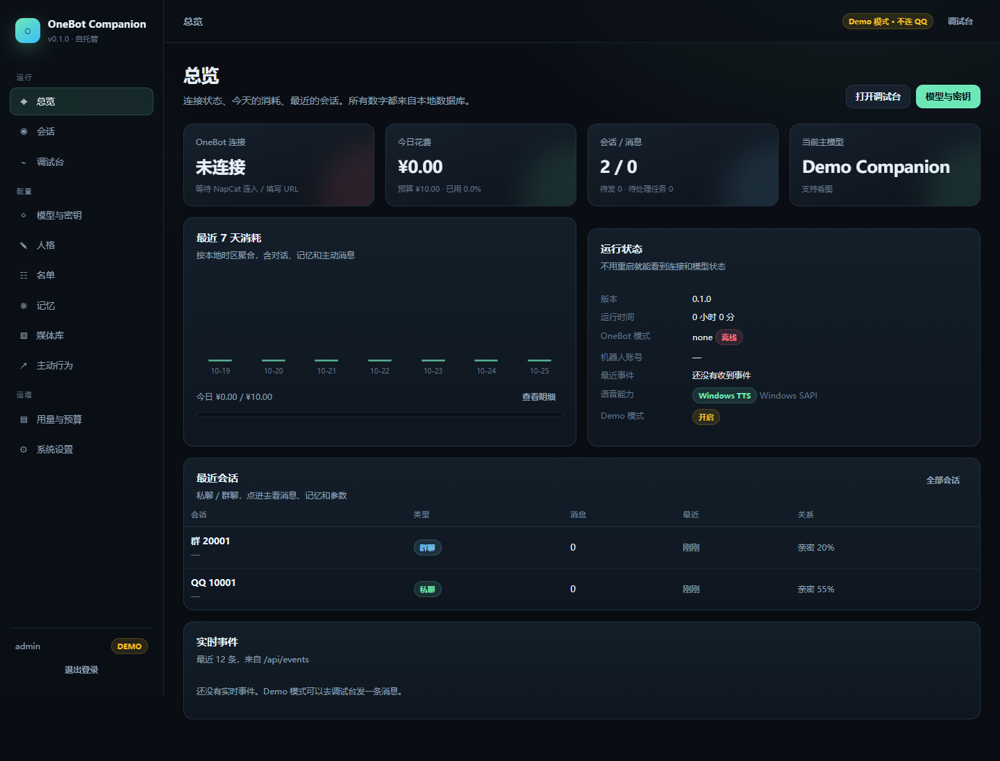
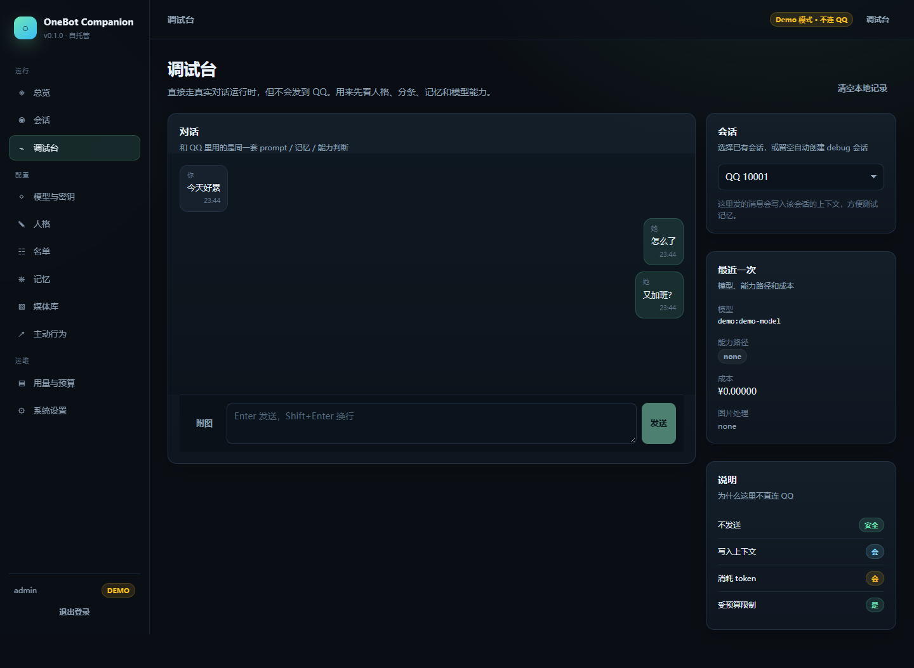
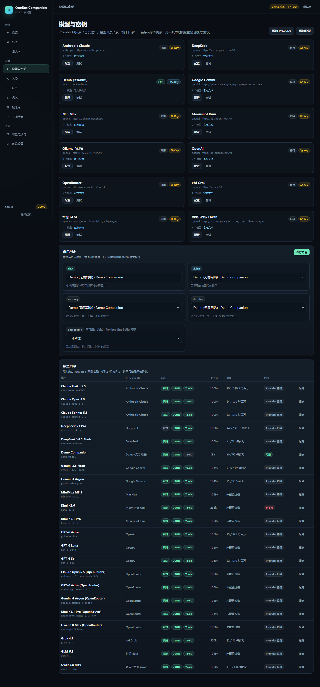

# OneBot Companion

一个可自托管、面向 **OneBot 11**（NapCat / Lagrange / LLOneBot 等）的 AI 聊天伴侣。

它不只是“收到消息 → 调模型 → 回一句”。它有自己的**人格、关系状态、长期记忆、主动行为、概率和预算**，会分条说话、会发表情包、会在 Windows 上用系统 TTS 发语音；模型不支持看图时，它会按人设承认“我看不到”，而不是假装看过。

> 当前版本：`0.1.0`。已用内置 mock 跑通完整对话链路；真实 NapCat 联调需要你提供可用的 WS 地址 / token。上线前请阅读[安全说明](docs/SECURITY.md)和[免责声明](#免责声明)。



<p>
  
  
</p>

---

## 功能

- **私聊 / 群聊**：独立会话、独立参数、独立记忆。
- **黑白名单**：私聊白名单/黑名单、群白名单/黑名单、群成员黑名单；默认拒绝，Owner 例外。
- **Web 管理端**：首次启动自动生成管理员账号密码，登录后强制改密。
- **多 Provider / 多模型**：DeepSeek、OpenAI、Anthropic Claude、Google Gemini、Kimi、通义千问、GLM、MiniMax、Grok、OpenRouter、Ollama、任意 OpenAI 兼容中转。
- **能力目录 + 主动探测**：每个模型声明/探测文本、JSON、视觉能力；支持看图时直接传图，不支持时走视觉旁路或按人设说明。
- **人格系统**：提示词、风格示例、边界、看不了图时的说法、语音风格、版本历史。
- **上下文与记忆**：工作记忆、滚动摘要、结构化事实、事件、日记、未闭环话题、关系状态；压缩前先 flush 记忆。
- **主动行为**：独立调度器，按时间/关系/未闭环话题/概率/上限主动发消息；静默时段、连续未回退避、用户回复取消待发。
- **拟人表达**：1~4 条分条、打字延迟、随机读消息延迟、表情包 / 图片、引用回复、Windows TTS 语音。
- **用量与预算**：每次调用记 token、缓存命中、成本；日预算/单会话预算/调用次数上限；预算预扣，防止并发超支。
- **加密存储**：消息正文、发送者名、摘要、事实、日记、未闭环、outbox、jobs、API Key 均字段级 AES-256-GCM 加密；管理员密码 Argon2id。
- **Windows / Linux**：Windows 原生脚本 + Linux Docker；CI 双平台验证。
- **Demo 模式**：没有 QQ、没有 API Key 也能打开管理端和调试台。
- **开源友好**：模型目录是 YAML 数据；OneBot / LLM / 视觉 / TTS 均可替换；无遥测；不打包版权素材。

---

## 快速开始

### 方式 A：先看 Demo（不需要 QQ / API Key）

```bash
pnpm install
pnpm build
pnpm demo
```

打开 <http://127.0.0.1:18080>，用启动日志里的初始管理员密码登录，进入「调试台」直接聊天。

Demo 使用 mock 模型，不会联网、不会发 QQ。

### 方式 B：Windows 正式运行

前置：Node.js 22+、pnpm。

```powershell
# 在项目根目录
.\scripts\setup.ps1
.\scripts\start.bat
```

`setup.ps1` 会安装依赖、构建、复制 `.env.example` 为 `.env`（如果不存在）。启动后打开 <http://127.0.0.1:8080>。

### 方式 C：Linux / Docker

```bash
cp .env.example .env
# 编辑 .env：至少改 ONEBOT_TOKEN，按需填 DEEPSEEK_API_KEY
docker compose up -d --build
```

管理端默认只映射到 `127.0.0.1:8080`。生产环境请用 Caddy/Nginx 加 HTTPS，参考 [部署文档](docs/DEPLOYMENT.md)。

### 首次登录

首次启动会：

1. 生成 `data/master.key`（请备份）；
2. 生成管理员账号密码，打印到控制台并写入 `data/initial-credentials.txt`；
3. 首次登录强制修改密码。

忘记密码：

```bash
node dist/server/cli.js reset-password
```

---

## NapCat 配置（反向 WS，推荐）

1. 启动 NapCat，扫码登录一个**小号**。
2. 打开 NapCat WebUI → 网络配置 → 新建 → **WebSocket 客户端**。
3. URL 填：
   ```text
   ws://<运行本程序的机器>:8080/onebot/v11/ws
   ```
   跨机/云端用 `wss://你的域名/onebot/v11/ws`。
4. Access Token 与 `.env` 里的 `ONEBOT_TOKEN` 保持一致。
5. 消息格式选 `array`，启用私聊/群聊事件与心跳。
6. 在本程序「名单」里把允许的 QQ / 群号加入白名单。
7. 在「模型与密钥」填入 DeepSeek（或其他）API Key，启用 Provider，把 `chat` 角色绑定到模型。

也可以使用正向 WS：程序连 NapCat 的 `ws://127.0.0.1:3001`，在「系统设置 → OneBot」切换模式。

> 详细步骤、Docker 网络、TLS 示例见 [docs/DEPLOYMENT.md](docs/DEPLOYMENT.md)。

---

## 模型与能力

模型名、价格、上下文和能力变化很快，所以**模型信息不写死在代码里**：

- `catalog/providers.yaml`：Provider 预设 + 模型目录。
- 管理端「模型与密钥」：填 Key、启用、测试、按角色绑定。
- 能力探测：用本地生成的测试图验证视觉；文本 / JSON / 视觉分别记录。
- 运行时按能力分支：
  1. 主模型支持视觉 → 直接传图；
  2. 主模型不支持、但绑定了视觉模型 → 先描述，再注入主模型；
  3. 都没有 → 不传图，按人格说“我看不到图”。

当前目录中的快照（2026-10）包括 DeepSeek V4.1 Flash / V4 Pro、GPT-6、Claude 5.5、Gemini 4、Kimi K3.1、Qwen3.8-Max、GLM-5.3、MiniMax M3.1、Grok 4.7、OpenRouter 与 Ollama。**以厂商控制台为准**，更新目录不需要改代码。

详见 [docs/MODEL_CAPABILITIES.md](docs/MODEL_CAPABILITIES.md)。

---

## 目录结构

```text
src/
  onebot/       OneBot 11 WS / 事件归一化 / 发送
  models/       Provider 适配 / 模型目录 / 能力探测 / 预算网关
  chat/         会话策略 / 上下文 / 人格提示词 / 回复计划 / outbox
  memory/       摘要 / 事实 / 日记 / 记忆 worker
  proactive/    主动消息调度
  media/        图片下载与视觉旁路 / Windows TTS / 表情包
  web/          Fastify API / 登录 / SSE / 静态管理端
  db/           SQLite schema / 迁移
  security/     主密钥 / 字段加密 / Argon2id
web/            React 管理端
catalog/        模型目录（数据）
docs/           架构 / 部署 / 安全 / 人格 / FAQ
tests/          单元 + 集成测试（mock OneBot / mock LLM）
```

---

## 常用命令

```bash
pnpm dev:server      # 后端热重载
pnpm dev:web         # Vite 管理端开发（代理到 8080）
pnpm build           # 构建 server + web
pnpm start           # 生产启动
pnpm demo            # Demo 模式（18080）
pnpm test            # 单元 / 集成测试
pnpm typecheck       # TypeScript 检查
pnpm cli doctor      # 检查 Provider / 角色 / 数据
pnpm cli backup      # 数据库备份
```

---

## 安全与隐私

- 消息正文、发送者名、摘要、事实、日记、未闭环、outbox、jobs、API Key 字段级加密；管理员密码 Argon2id。
- API Key **只写不读**：管理端只显示是否已配置，不返回明文。
- 登录 Cookie + CSRF + 登录限速 + 审计日志。
- 图片下载做 SSRF 校验；模型默认没有工具权限；不执行聊天里的指令。
- 无遥测；日志默认不记录消息正文；Demo 模式不联网。
- 数据流：QQ → NapCat → 本程序；对话内容会发送给你配置的模型 Provider（也可用 Ollama 本地模型）。

**边界**：字段加密能防拖库、备份泄露、磁盘丢失；如果攻击者拿到运行中的 root，密钥在内存里，加密救不了。云端请同时开启磁盘加密、最小权限、HTTPS 和防火墙。详见 [docs/SECURITY.md](docs/SECURITY.md)。

---

## 已知限制

- 真实 NapCat 联调尚未进行；协议层按 OneBot 11 标准实现，拿到 URL/token 后需要做一次连通性验证。
- 数据库整库加密（SQLCipher）在当前 Windows/Node 24 环境下没有稳定预编译包，因此默认采用**字段级加密**；Linux 可用磁盘加密补齐。
- 语音仅 Windows SAPI 可用；Linux 暂不启用本地 TTS。
- 语音转写（ASR）、视频、AI 生图、插件市场、多账号 UI 不在 v1 范围。
- 群聊主动行为默认非常保守；请先小号、小群、低频测试，避免 QQ 风控。

---

## 参与贡献

欢迎 issue / PR，尤其是：

- 新 Provider / 模型目录更新（只改 `catalog/providers.yaml`）；
- OneBot 兼容性修复；
- 新的 TTS / 视觉 Provider；
- 文档、翻译、部署脚本。

提交前请跑 `pnpm typecheck && pnpm test`。模型目录 PR 请附官方文档链接与 `verified_at`。

---

## 免责声明

本项目与腾讯 / QQ / NapCat / 各模型厂商无隶属关系。NapCat 等非官方协议端存在账号风控风险；请使用小号、遵守 QQ 用户协议和当地法律，不要用于骚扰、诈骗、群发广告或绕过平台限制。AI 生成内容请自行甄别。

## License

MIT
